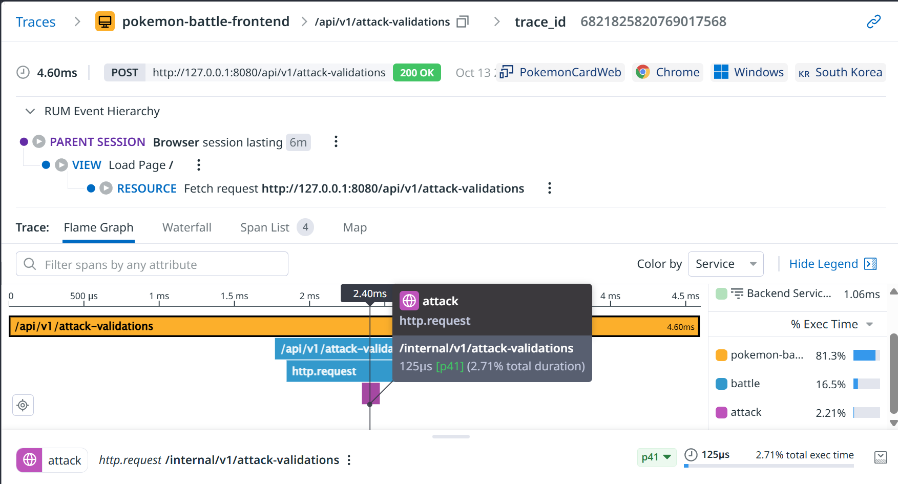
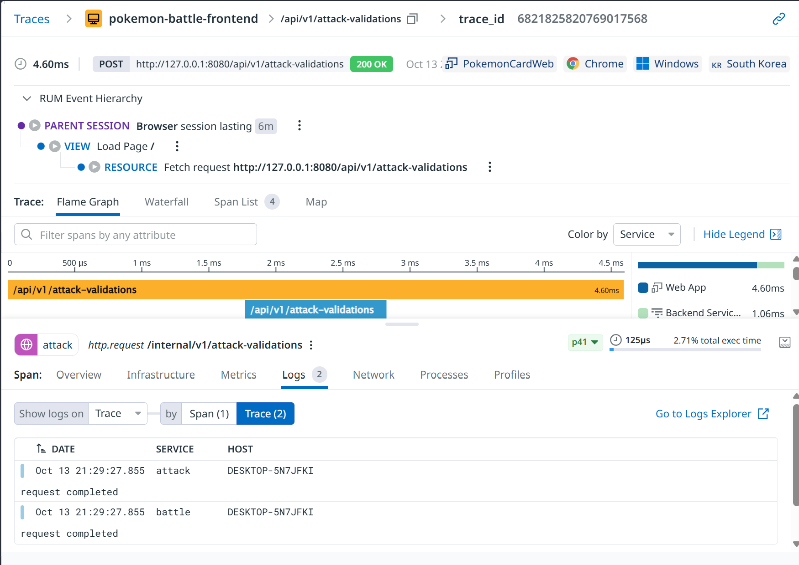
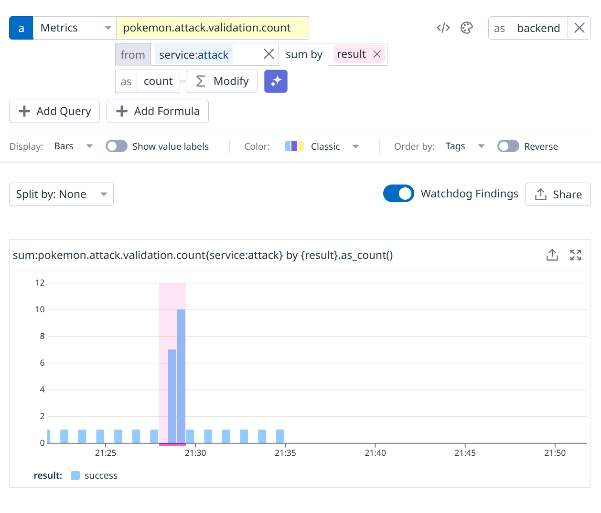
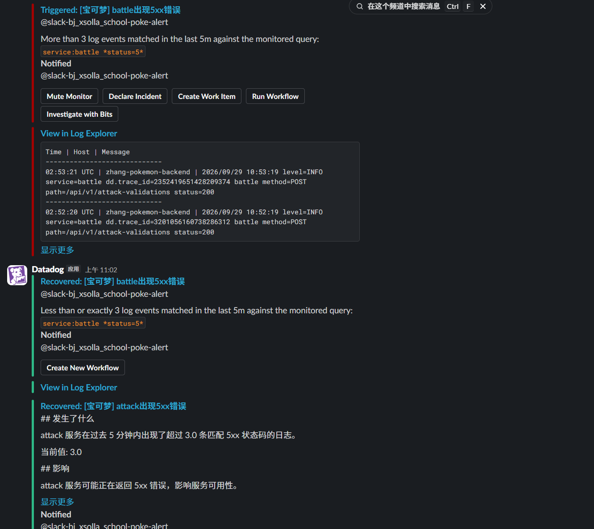

# 可观测性文档（OBSERVABILITY）

## 架构

```
浏览器（前端）
    │  POST /api/v1/attack-validations
    ▼
battle（:8080）───HTTP───▶ attack（:8081）
    │                        │
    └── dd-trace-go ─────────┘
         （分布式 trace：battle→attack 一条链路）
```

- **前端**：浏览器里的宝可梦对战游戏，玩家点击投掷球触发攻击。
- **battle**：对外网关，接收前端请求，转发给 attack，原样返回状态码， 除传数据外无其他功能。
- **attack**：校验攻击类型与固定伤害是否匹配，返回 200/400/422。

## 四大支柱埋点位置


| 支柱             | 在哪里埋的                                                                                                                                                                                                                                                                                                                                                                                                                                                 |
| -------------- | ----------------------------------------------------------------------------------------------------------------------------------------------------------------------------------------------------------------------------------------------------------------------------------------------------------------------------------------------------------------------------------------------------------------------------------------------------- |
| **Trace（APM）** | `attack/main.go`、`battle/main.go`：`ddhttp.WrapHandler` 包裹入口，`ddhttp.WrapClient` 包裹转发客户端，battle→attack 上下文自动透传。attack 校验时打自定义 span tag `attack.type`。                                                                                                                                                                                                                                                                                                  |
| **日志（Log）**    | `logWithTrace()` 函数输出 `level= service= dd.trace_id=` 结构化日志，实现 log↔trace 互跳。失败路径（422/500/转发失败）打 ERROR，参数错误打 WARN。                                                                                                                                                                                                                                                                                                                                      |
| **指标（Metric）** | attack 每次校验后通过 DogStatsD 发 pokemon.attack.validation.count{result:success\|failure, env, version, service, team} 业务指标；失败率 = `result:failure` 请求数（按 HTTP 400–599 以及 无响应码 0） / 总请求数。系统资源（CPU/内存/磁盘）由 Datadog Agent 自动采集。|
| **RUM**        | `src/monitoring/rum.js` 初始化 Datadog RUM（`PokemonCardWeb`），从 `.env` 读取应用 ID 和客户端 Token，数据上报至 us5.datadoghq.com。采集页面浏览、用户操作、网络请求和 Long Task；会话采样率为 100%，回放采样率为 20%。统一标签为 `service:pokemon-battle-frontend`、`env:school`、`version:1.0.0` 及 `team`。前端开发面板的演练按钮通过 `reportRumAction` / `reportRumError` 上报 `dev_*` action 与 error 事件。 |


## 监控表

> monitors/ 目录下共 10 个 JSON，与线上 Datadog 监控器一一对应，队友可通过下方命令从 git 复现。
>
> 考虑到组内成员的工作时间，以及这个项目的大小。我们选择了可持续性最高的告警，仅仅通过 Slack 通知

| 监控器               | 类别      | 阈值                                                | 通知    |
| ----------------- | ------- | ------------------------------------------------- | ----- |
| battle 服务健康检查     | 可用性/心跳  | can_connect 5 分钟均值 < 0.9（Agent 每 60 秒 POST 真实业务请求） | Slack |
| battle 出现 5xx 错误  | 错误（总闸）  | 5 分钟内 5xx 日志 > 3 条                                | Slack |
| attack 出现 5xx 错误  | 错误（专报）  | 5 分钟内 5xx 日志 > 3 条                                | Slack |
| CPU 持续过高          | 资源饱和    | system.cpu.user > 95% 持续 15 分钟                    | Slack |
| 内存可用不足            | 资源饱和    | system.mem.pct_usable < 10% 持续 15 分钟              | Slack |
| P95 延迟过高          | 延迟 SLO  | battle P95 > 500ms（5 分钟窗口；trace 指标单位是秒，查询里即 0.5） | Slack |
| attack 校验失败率过高    | 业务结果    | 5 分钟内 `pokemon.attack.validation.count` 失败率 > 20% | Slack |
| 前端 RUM 错误         | 前端（RUM） | 5 分钟内 RUM error 事件 > 4 条                          | Slack |
| 前端非预期 4xx        | 前端（RUM） | 5 分钟内非预期 4xx Resource 请求 > 5 条（warning，排除 404/422） | Slack |
| supervisor 进程故障级别 | 进程/心跳   | failure_level 警告 ≥1、告警 ≥2（2 分钟窗口）                | Slack |

### 阈值理由（结合业务场景）

每条阈值都从下面的部署形态推导而来：

- **单机共享**：前端 dev server、battle、attack、supervisor、Datadog Agent 全部跑在一台日常使用的个人 Windows 电脑上，宿主机负载和游戏组件互相影响。
- **低流量**：玩家就是组内成员和评审，正常每分钟个位数请求，按大流量网站的比例阈值设计会全部失真。
- **业务语义**：玩家投掷道具 → 前端提交伤害校验 → 伤害不匹配返回 422 判负结束本局；battle 调 attack 超时 500ms；玩家操作问题只会产生 400/422，5xx 与玩家行为无关。

逐条理由：

- **battle 健康检查 < 0.9**：battle 是游戏唯一入口，挂掉等于所有人都进不了对局。探测本身就是一次真实校验请求，走完 battle→attack 全链路，任一环故障都会失败。每 60 秒一次、5 分钟约 5 个探测点，失败 1 次均值即跌到 0.8 破线——单次真实失败就告警，同时用 5 分钟均值窗口吸收 Agent 采集的瞬时抖动。该监控还开启了 no-data 告警（10 分钟没有探测数据即触发），Agent 或宿主机本身失联也能兜住。
- **battle/attack 5xx > 3 条/5 分钟**：5xx 只来自服务自身异常或转发失败（battle 的 502/503/504），出现即基础设施问题。正常水位是 0，3 条已远超水位；不再放低是给 attack 重启窗口这类瞬态留余量，避免刷屏。两者分工：只有 attack 红 → 校验服务自身问题；两个一起红 → 多半是 attack 挂了引发 battle 连环 503。
- **CPU > 95% 持续 15 分钟**：宿主机同时用于日常办公/编译，分钟级 CPU 飙高是常态，按瞬时值告警会天天误报；但游戏全家桶也在这台机器上，持续打满 15 分钟意味着校验请求开始排队（P95 监控会同步变红），此时才值得人来看。
- **内存可用 < 10% 持续 15 分钟**：同样因为共享宿主机——跌破 10% 后 Windows 开始换页，前端、两个 Go 服务、Agent 一起变慢，进程还可能被系统回收（进而触发 supervisor 监控）。15 分钟持续条件排除大型程序启动时的短时波动。
- **P95 > 500ms**：500ms 正是 battle 调 attack 的超时上限，到点直接 504、当次投掷判负，玩家感受是"点了没反应/莫名输掉"。P95 破线表示至少 5% 的投掷已走到超时路径，游戏实际不可用，因此阈值直接对齐超时值，而不是另拍一个延迟数字。
- **校验失败率 > 20%**：422 表示类型合法但伤害不匹配。正常前端上报的伤害与 attack 固定表永远一致，玩家不应收到 422；个位数失败更可能是有人改包作弊，而 20% 的失败率只可能来自系统性问题（前端发错版本、伤害表不同步），此时每个对局中的玩家都会被误判出局。健康检查探不到这类问题（服务不是 5xx），需独立监控。
- **前端 RUM 错误 > 4 条/5 分钟**：JS 报错直接砸在对局画面上（React 崩溃即白屏），用户立即感知；并发是个位数，4 条扎堆只能来自共性缺陷（坏版本、浏览器兼容），而非分散的偶发错误。
- **前端非预期 4xx > 5 条/5 分钟（warning）**：前端可见的 4xx 里，422 是游戏机制内的正常结果（伤害不匹配判负）、404 已在查询中排除；剩下的 400/405 等不可能由玩家操作触发——只可能是前端自己把请求发坏了（版本 bug、Content-Type/JSON 构造出错）。此时每个投掷都失败，但健康检查依然全绿（探测的是合法请求）、5xx 监控也不响，属于两者都照不到的盲区，所以单独补一条。流量个位数，warning 5 条足够；critical 阈值刻意抬到 100 万，只警告不打扰。
- **supervisor 警告 ≥1 / 告警 ≥2**：supervisor 每 3 秒查一次进程、崩溃自动拉起、1 小时内第二次崩溃才停止重启。=1 表示单次崩溃已被拉起、游戏只是短暂中断，暂不打扰人；≥2 表示反复崩溃、自动恢复已放弃、游戏实际下线，需要人介入。

### 游戏漏斗观察口径

一次对局本身就是条业务漏斗。我们没有为漏斗单建监控器，但四层数据横跨 RUM 与后端指标、可互相交叉验证（前端看到的和后端收到的对不对得上），在 RUM Explorer / Metrics Explorer 里按下表即可现查：

| 层 | 含义 | 查询 |
| --- | --- | --- |
| L1 打开页面 | 玩家进入游戏 | RUM：`@type:view service:pokemon-battle-frontend` |
| L2 有效交互 | 打开后真的开始玩了 | RUM：`@type:view @view.action.count:>0`（交互率 = L2 ÷ L1） |
| L3 发起校验 | 投掷触发一次后端校验 | RUM：`@type:resource @http.url:*attack-validations*`，或指标 `trace.http.request.hits{service:battle}` |
| L4 校验成功 | 这次投掷被判定有效 | 指标：`pokemon.attack.validation.count{result:success}` |

层间背离就是各自的排查入口：L2 占比低 → 疑似白屏/JS 报错（结合「前端 RUM 错误」监控看）；L3 明显低于 L2 → 玩家在投掷但请求没到后端；L4 与 L3 背离 → 422 判负扎堆（即「attack 校验失败率过高」监控的另一种看法）。


## 文件结构

```
backend/
  attack/main.go          # APM + 日志 + 业务指标
  battle/main.go          # APM + 日志
  datadog/
    http_check.d/conf.yaml    # battle/attack 健康检查
    pokemon.d/conf.yaml       # 日志采集
monitors/                   # 监控器定义（as-code，与线上监控器一一对应）
  battle-health-monitor.json          # ↔ 线上：battle服务健康检查
  battle-5xx-monitor.json             # ↔ 线上：battle出现5xx错误
  attack-5xx-monitor.json             # ↔ 线上：attack出现5xx错误
  cpu-monitor.json                    # ↔ 线上：CPU持续过高
  memory-monitor.json                 # ↔ 线上：内存可用不足
  battle-latency-p95-monitor.json     # ↔ 线上：P95延迟过高
  attack-validation-failure-rate-monitor.json  # ↔ 线上：attack校验失败率过高
  pokemoncard-supervisor-failure-level.json  # ↔ 线上：进程故障级别监控
  rum-frontend-error-monitor.json     # ↔ 线上：前端JS异常
  rum-frontend-unexpected-4xx-monitor.json  # ↔ 线上：前端非预期4xx
```

> 注：其余 team:bj-xsolla-school-group-2 的监控与本项目无关


## Datadog Agent 启动与配置

系统指标（CPU/内存/磁盘）、日志采集、battle/attack 主动健康探测、DogStatsD 指标接收，全部依赖本机 Datadog Agent（Windows MSI 安装，以系统服务常驻）。核心配置两处：

- `C:\ProgramData\DataDog\datadog.yaml`：主配置。本机已固定 `hostname: zhang-pokemon-backend` 并开启 `logs_enabled: true`——监控器里的 `host:zhang-pokemon-backend` 过滤依赖这个固定主机名，换机器或改主机名时需同步更新。
- `C:\ProgramData\DataDog\conf.d\`：各集成检查的子配置。仓库 `backend/datadog/` 下的两份需复制过去（目录名必须一致，Agent 按目录名识别检查类型）：

| 仓库文件 | 复制到 | 作用 |
| --- | --- | --- |
| `backend/datadog/http_check.d/conf.yaml` | `C:\ProgramData\DataDog\conf.d\http_check.d\conf.yaml` | 每 60 秒 POST 真实业务请求，探测 battle（走全链路）和 attack |
| `backend/datadog/pokemon.d/conf.yaml` | `C:\ProgramData\DataDog\conf.d\pokemon.d\conf.yaml` | 采集 `C:/dd-logs/` 下 battle/attack/supervisor 三个日志文件 |

日志来源：`run_supervisor.py` 把三个服务的输出 tee 到 `C:\dd-logs\*.log`（supervisor.log 由脚本直写），Agent 只负责 tail，所以日志采集的前提是 supervisor 在跑。

### 启动 / 重启 / 验证（管理员 PowerShell）

修改 conf.d 下任何配置后必须重启 Agent 才生效：

```powershell
Restart-Service datadogagent                                       # 重启 Agent 服务
& "C:\Program Files\Datadog\Datadog Agent\bin\agent.exe" status    # 整体状态（含各检查是否在跑）
& "C:\Program Files\Datadog\Datadog Agent\bin\agent.exe" check http_check   # 单跑一次探测，验证配置
```

### 启动顺序与 DogStatsD

attack 的业务指标和 supervisor 的 `failure_level` 都通过 UDP 发往 `127.0.0.1:8125`（attack 固定此地址；supervisor 可用根目录 `.env` 的 `DATADOG_AGENT_HOST` / `DD_DOGSTATSD_PORT` 覆盖）。DogStatsD 是 fire-and-forget：Agent 没在跑数据就丢、不会补发，所以**先起 Agent，再起 supervisor/后端**。根目录 `.env`（参考 `.env.example`）相关变量：

| 变量 | 用途 |
| --- | --- |
| `DATADOG_AGENT_HOST` / `DD_DOGSTATSD_PORT` | supervisor 发指标的目标地址（默认 127.0.0.1:8125） |
| `DD_API_KEY` / `DD_APP_KEY` / `DD_SITE` | `sync_datadog_monitor.py` 同步监控器到线上用 |
| `VITE_DD_APPLICATION_ID` / `VITE_DD_CLIENT_TOKEN` | 前端 RUM 初始化（只放 client token，绝不放 API/App key） |


## 应用监控器

用 `sync_datadog_monitor.py` 批量创建或更新（as-code）：

```bash
# .env 里配好 DD_API_KEY / DD_APP_KEY / DD_SITE
py sync_datadog_monitor.py --dry-run   # 先预览
py sync_datadog_monitor.py             # 实际应用
```


## 复现方式（从零到有告警）

把散在各节的步骤串成一条路，新队友按顺序执行即可：

```powershell
# 1. 根目录 .env：按 .env.example 填好（各变量用途见「Datadog Agent 启动与配置」）
# 2. 把 backend/datadog/ 下两份 conf.yaml 复制进 C:\ProgramData\DataDog\conf.d\（对照表见上节）
# 3. 按依赖顺序启动：Agent → supervisor → 浏览器
Restart-Service datadogagent           # 重启 Agent 加载新 conf
py run_supervisor.py                   # 拉起前端 + battle + attack，输出 tee 到 C:\dd-logs\
# 4. 浏览器打开 http://localhost:5173，开始战斗并投掷几次，让指标/日志/RUM 先注册
# 5. 同步监控器（见上节两条命令）
```

验证四件事：`agent.exe status` 里 http_check / pokemon 两个检查在跑；Metrics Explorer 查得到 `pokemon.attack.validation.count`；Logs Explorer 有 `service:battle` 且带 `dd.trace_id`；RUM Explorer 能看到 `pokemon-battle-frontend` 的 view。之后用前端开发面板的故障演练按钮制造 5xx/422，Slack 频道应能收到对应告警。


## 截图


### （a）RUM → trace → log




RUM 里点开一次校验请求，关联出该请求的 APM trace，火焰图覆盖 battle→attack 整条链路。



从 trace 查看关联日志

### （b）业务指标



attack 每次校验后按 `result:success|failure` 打点计数（DogStatsD → Agent → Datadog），是「attack 校验失败率过高」监控器的数据源。上图为 Metrics Explorer 按 `result` 分组的计数，21:29 前后的尖峰是一波集中投掷，Watchdog 自动标记了异常点。查询：

```
sum:pokemon.attack.validation.count{env:school,service:attack,team:bj-xsolla-school-group-2} by {result}.as_count()
```

### （c）Slack 告警触发与恢复


上图展示：

- **触发**：battle 5 分钟内出现超过 3 条 5xx 日志，告警变红，通知到 Slack 频道
- **恢复**：错误数回落后，自动发送恢复通知
